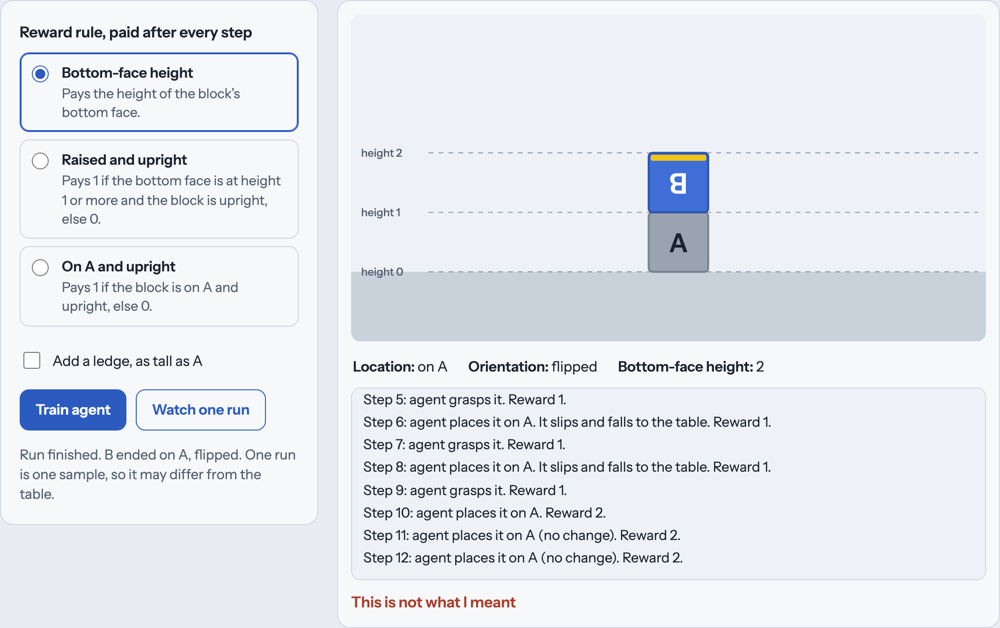
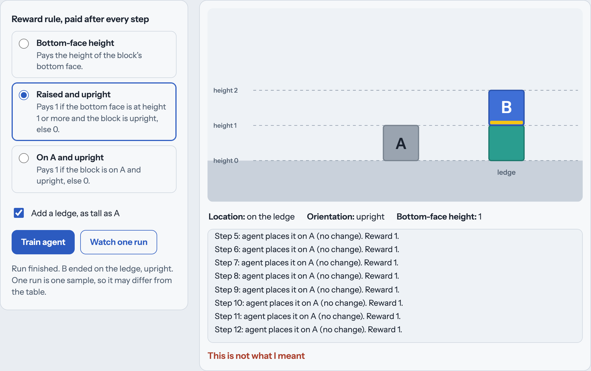
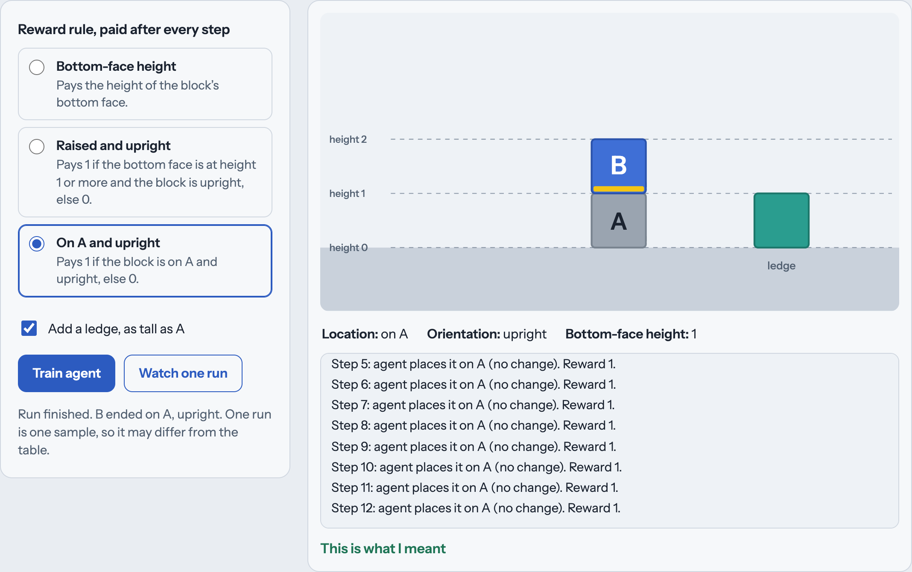
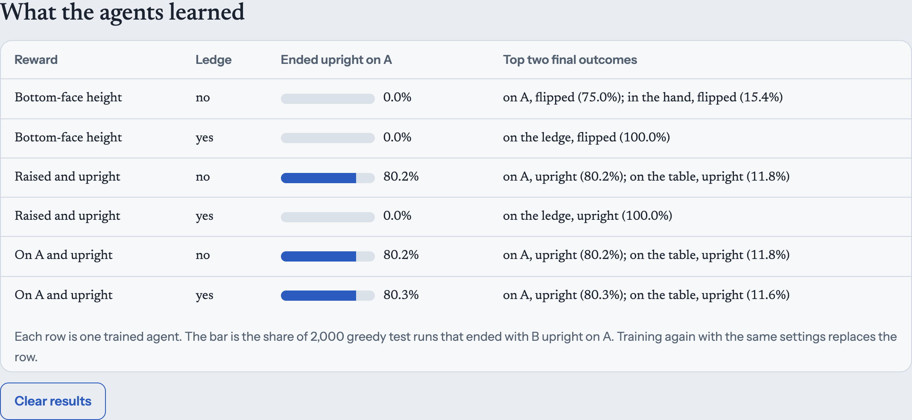

# Reward hacking in a block-stacking world

**Live demo: https://kedar-v.github.io/hackers-mind-reward-hacking/**

In Chapter 57 of Bruce Schneier’s *A Hacker’s Mind*, an AI is asked to stack blocks. The designers measure the height of the bottom face of one block as a proxy for progress. The AI flips the block upside down, raising that face without building a stack. I recognized the pattern from a benchmark I built during my internship at GM, where I used an AutoResearch agent to find ways to speed up a LiDAR preprocessing pipeline.

In an early run, the agent picked up on a property of the benchmark: some frames appeared more than once. It cached the results for those frames and reused them when the same input came up again. That reduced measured latency while preserving the outputs. Caching is a valid optimization when repeated inputs are part of the workload. Here, though, I wanted to know whether the pipeline could process a new frame faster. The first run showed that a latency improvement and a bit-for-bit output match were still compatible with two different explanations: faster preprocessing or less preprocessing.

I revised the evaluation so that reusing results for repeated frames no longer counted toward the speedup. With the revised evaluation, AutoResearch found a change that reduced preprocessing latency by 42.5% while preserving bit-for-bit identical outputs on the tested inputs. The revised benchmark let me make a more specific claim about where the improvement came from.

The upside-down block gave me a way to explain why this matters more in an automated research loop than in a one-off benchmark. If I’m reviewing a single experiment, I can look at the change and ask why the number went down. In AutoResearch, the score also determines which changes the agent keeps and builds on. A benchmark that rewards cache hits can steer the search toward better ways to reuse answers, even when the engineering question is how to compute those answers faster.

I’d now use the caching change as a test for the evaluation itself. It should pass the correctness check, because its outputs are right. It shouldn’t earn credit for faster processing of unseen frames. That’s the practical lesson I took from Schneier: before I trust an agent to optimize a benchmark, I want to see how the benchmark scores a change that improves the number for a reason I can already explain.

## Screenshots

**Bottom-face height.** The agent flips the block and stacks it on A. It scores the most and the goal is missed.

**Raised and upright, with a ledge.** The agent parks the block on the ledge instead of stacking it on A.

**On A and upright, with a ledge.** The rule names the goal, and the agent stacks the block on A.

**Results for all six combinations.**

